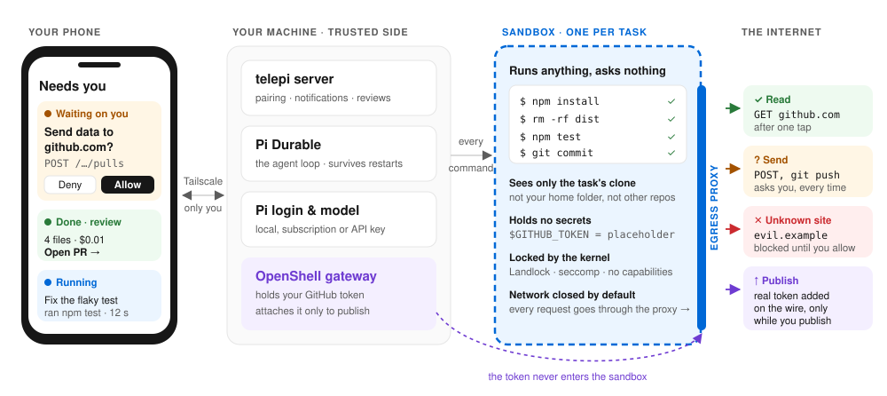

# telepi

**Let a coding agent work unattended on your own machine, because it cannot get out.**

Hand a task to an agent from your phone. It works in a sandbox on your computer, with any model you like, and only asks you when something would leave that sandbox.

<p align="center">
  
</p>

## Why

Agents delete the wrong folder, follow instructions hidden in a README or an issue, and keep getting better at finding tokens. Today you either watch every command, or hand your code to someone else's cloud. telepi is the third option: run it at home, let it do anything inside a box, and decide only what crosses the edge.

- **Your machine is safe.** Each task gets its own [NVIDIA OpenShell](https://github.com/NVIDIA/OpenShell) sandbox. `rm -rf` runs without asking; the worst case is a throwaway container.
- **Your code stays put.** The network is closed. Reading from a site you approved is fine; **sending** anything anywhere asks you first.
- **Your tokens never go in.** OpenShell adds them to requests on the way out, only while you publish.
- **Any model.** Local, subscription or API key, through [Pi](https://github.com/earendil-works/pi)'s own login.
- **Your phone, only when needed.** Approvals, questions and a review with the diff, cost and a one-tap pull request.

## Install

You need Docker, Node 22+, pnpm, git and a [Pi](https://github.com/earendil-works/pi) login (`pi`, then `/login`).

```
git clone https://github.com/onurceri/telepi && cd telepi
./install.sh
```

It checks what is missing and tells you how to fix it, starts everything and prints a QR code. Scan it with your phone. For the phone to install the app it needs HTTPS: with [Tailscale](https://tailscale.com), run `pnpm telepi pair --tailscale`.

```
pnpm telepi project add <path-or-git-url>   # a repo for the agent to work on
pnpm telepi doctor                          # something wrong? start here
pnpm telepi start | stop | status | pair     # stop ends everything, sandboxes and gateway too
pnpm telepi uninstall                       # removes everything telepi made; lists it and asks first
```

To publish to GitHub, put a [fine-grained token](https://github.com/settings/personal-access-tokens/new) (Contents and Pull requests: read and write) in `~/.telepi/env` as `TELEPI_GITHUB_TOKEN=...`.

## Status

Early. It works end to end on macOS: real tasks, approvals, pushes and pull requests on github.com. Linux has not been tried. It builds on [Pi Durable](https://github.com/earendil-works/pi/tree/main/packages/durable) (experimental) and OpenShell 0.1.3, so expect rough edges.

## More

- [How it works, every setting, development](docs/reference.md)
- [What it does and does not protect against](SECURITY.md)
- [Contributing](CONTRIBUTING.md)

MIT licensed.
